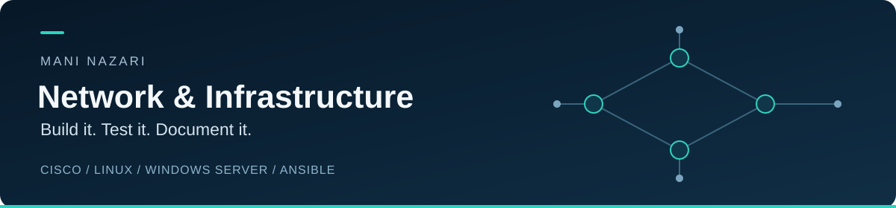

  

  <a href="https://www.linkedin.com/in/manirootnet/"><strong>LinkedIn</strong></a>
  &nbsp; · &nbsp;
  <a href="https://github.com/ManiRootNet/shanghai-2026-enterprise-network-lab">Cisco case study</a>
  &nbsp; · &nbsp;
  <a href="https://github.com/ManiRootNet/shanghai-2026-linux-infrastructure-lab">Linux case study</a>

I’m **Mani Nazari**, a network engineer building and troubleshooting networks and systems. I document the topology, test conditions and observed results so another engineer can review the work.

My focus is **Cisco networking, Linux infrastructure and Ansible automation**, alongside Windows Server, PowerShell and virtualization. My internship and on-site work also include structured cabling, endpoint connectivity and infrastructure support.

## Selected projects

<table>
<tr>
<td width="50%" valign="top">
<h3>Cisco enterprise networking</h3>

<strong>22 nodes · EVE-NG · Four sites</strong>

HQ, a data centre and two branches connected through a simulated ISP. Named EIGRP for IPv4/IPv6, OSPF, BGP policy, dual-hub DMVPN, HSRP and LACP.

<strong>Evidence:</strong> 36 access-policy checks matched the intended allow/deny rules, with selected NAT/NHRP records and controlled WAN failure tests.

<a href="https://github.com/ManiRootNet/shanghai-2026-enterprise-network-lab"><strong>Explore the project →</strong></a> 
<a href="https://github.com/ManiRootNet/shanghai-2026-enterprise-network-lab/blob/main/docs/validation-report.md">Validation report</a> · <a href="https://github.com/ManiRootNet/shanghai-2026-enterprise-network-lab/blob/main/docs/skills-and-evidence.md">Skills &amp; evidence</a>

</td>
<td width="50%" valign="top">
<h3>Linux infrastructure &amp; recovery</h3>

<strong>Seven Debian nodes · VMware · Ansible</strong>

Directory-backed access, TLS services, OpenVPN, RAID5/NFS storage and Prometheus monitoring across routed networks.

<strong>Evidence:</strong> 81 passing functional checks, four Node Exporters UP, file-integrity checks after reboot and a four-change recovery drill followed by an idempotent Ansible run.

<a href="https://github.com/ManiRootNet/shanghai-2026-linux-infrastructure-lab"><strong>Explore the project →</strong></a> 
<a href="https://github.com/ManiRootNet/shanghai-2026-linux-infrastructure-lab/blob/main/docs/validation.md">Validation report</a> · <a href="https://github.com/ManiRootNet/shanghai-2026-linux-infrastructure-lab/blob/main/docs/visual-evidence.md">Visual evidence</a>

</td>
</tr>
</table>

## Technical focus

| Area | Tools and technologies |
| --- | --- |
| Networking | Cisco IOS, EIGRP, OSPF, BGP, DMVPN, VLANs, HSRP, LACP |
| Linux & services | Debian, LDAPS, DNS, TLS, OpenVPN, NFS, RAID5 |
| Automation & observability | Ansible, Git, Bash, PowerShell, Prometheus, Grafana |
| Systems & lab platforms | Windows Server, Active Directory, VMware, EVE-NG, XCP-ng, HPE iLO |

## Current focus

Preparing for **WorldSkills Aichi 2028 in IT Network Systems Administration**. The two published case studies use **Shanghai 2026 Module C and Module A** as independent practice references. Their test counts describe the checks recorded in each repository.

I’m open to **junior network and infrastructure opportunities** and technical conversations about routing, systems administration and automation.

**[Connect on LinkedIn](https://www.linkedin.com/in/manirootnet/)**

<!-- Keep claims tied to the linked evidence. Update this profile as new projects are validated. -->
